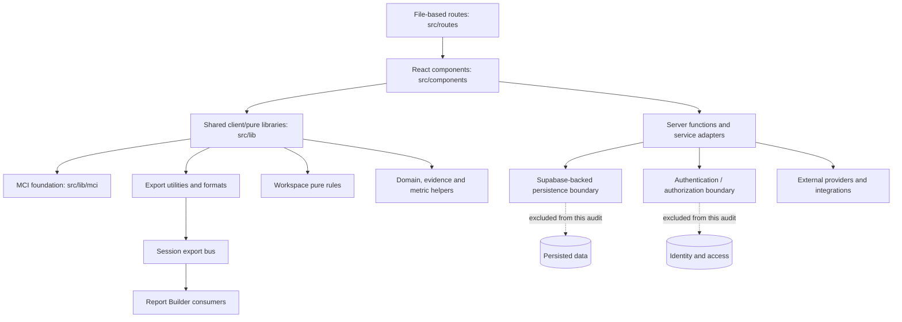

# MAAROOF Ai — P0 Architecture Map (Evidence-Bounded)
**Date:** 2026-11-17  
**Repository:** `ahmedfouaadqi-glitch/maaroof-ai`  
**Branch:** `feat/non-destructive-owner-workspaces-reports-2026-11-17`  
**Status:** PARTIAL — P0 remains OPEN.

## 1. Evidence boundary
This map is based on repository tree metadata and selected source files reviewed statically. It is not a complete runtime architecture map. Supabase, auth internals, database schemas/policies/migrations, API service handlers, secrets and protected engine/catalog contents are intentionally excluded. No runtime calls or live probes were made.

## 2. Verified top-level source inventory
At branch head `eae28f38718f64520c6218ec5160b55df901f9bf`, the complete recursive Git tree reported:
- 66 files under `src/routes/**`.
- 205 files under `src/components/**`.
- 364 files under `src/lib/**`.

These are file counts, not counts of verified features or operational capabilities.

## 3. Evidence-bounded logical map

Solid arrows represent observed import/use relationships in reviewed files. Dashed nodes are boundaries intentionally not inspected; they are not assertions about their internal implementation.

## 4. Reviewed subsystems and evidence

### 4.1 Routes and presentation
- File-based route source lives under `src/routes/**`; the public subset reviewed includes landing, contact, guide, GEO guides, methodology, sitemap, privacy and terms.
- The route tree also contains authenticated, workspace, admin, profile, API and integration paths. Those were not followed where their call chains could cross excluded auth/data services.
- Presentation is distributed across `src/components/**`, including export controls, report builder, workspace-space UI, approval queue, history, engine probe and audit pulse components.

### 4.2 MCI
- Pure foundation modules under `src/lib/mci/**` include types, canonical entity normalization, context budgeting, freshness gate, evidence gate, provenance, context selection and registry.
- `src/lib/mci/index.ts` describes this foundation as not yet wired into tools.
- Historical `docs/MCI_AUDIT.md` documents earlier MCI wiring and reuse. Current call-site coverage and persistence remain unresolved; do not merge historical and current claims into a single verified statement.

### 4.3 Workspace rules
- Pure rules: `account-kinds.ts`, `space-structure.ts`, `workspace-scope.ts`, `workspace-panels.ts`.
- UI integration: `WorkspaceSpacesPanel.tsx`.
- Service/persistence integration is through workspace and teaching server functions and is excluded from this map.
- Unit tests cover selected pure rules and mocked guard behavior, not full persisted isolation.

### 4.4 Export and reports
- Format and content helpers include `exports.ts`, `machine-pack.ts`, `export-content-translation.ts`, `export-identity.ts`, task export helpers and `export-bus.ts`.
- `ExportButtons.tsx` presents format actions and calls a translation server function.
- `ToolResultExport.tsx` serializes/captures tool results and calls history persistence.
- `ReportBuilder.tsx` combines captured results with history/metrics but imports Supabase directly; it is excluded beyond its import boundary.
- The export bus is a module-global map keyed by tool key only. This creates a credible cross-workspace contamination risk if consumers share the same module instance while switching workspaces; the exact runtime lifecycle remains unverified.

### 4.5 Approval and deletion surfaces
- `ApprovalQueue.tsx` calls server functions for pending approvals, approval/publishing and rejection; service authorization is not reviewed.
- `ToolHistory.tsx` exposes per-item deletion and clear-all actions.
- `WorkspaceSpacesPanel.tsx` exposes descendant-aware workspace deletion with a confirmation prompt.
- Underlying persistence, soft-delete/hard-delete semantics, cascade behavior, restore capability and retention are unknown because service/data boundaries are excluded. These are high-priority P0 risks under the non-destructive requirement.

## 5. Explicitly excluded nodes
The following are not mapped internally:
- Supabase client behavior, database tables, SQL, RLS, policies, migrations, triggers, storage and persisted data.
- Authentication internals and session/ownership enforcement where tied to the excluded service boundary.
- API route implementations whose handlers reach the excluded services.
- Protected engine/catalog files and tests.
- External paid/live provider behavior.

These exclusions must remain marked UNVERIFIED, not PASSED.

## 6. Architecture questions still open
1. Which routes and server functions are fully owner-scoped at every persistence boundary?
2. Are reports, templates, drafts, history, evidence and exports consistently workspace-scoped?
3. Can the export bus mix results after workspace switching or concurrent tabs?
4. Do workspace and history deletion operations archive, soft-delete or hard-delete, and what dependent records are affected?
5. Which current tools call the MCI foundation, and which historical MCI wiring docs refer to older implementation?
6. What are the complete non-Supabase dependencies and trust boundaries for each route and component?
7. Which background jobs and asynchronous processes retain workspace identity throughout their lifecycle?

## 7. P0 disposition
This architecture map is an evidence-bounded partial artifact. It is not sufficient to pass P0. It must be reconciled with the repository inventory, feature matrix, risk register, test-to-feature map and protected-file manifest before any P1 code changes begin.
